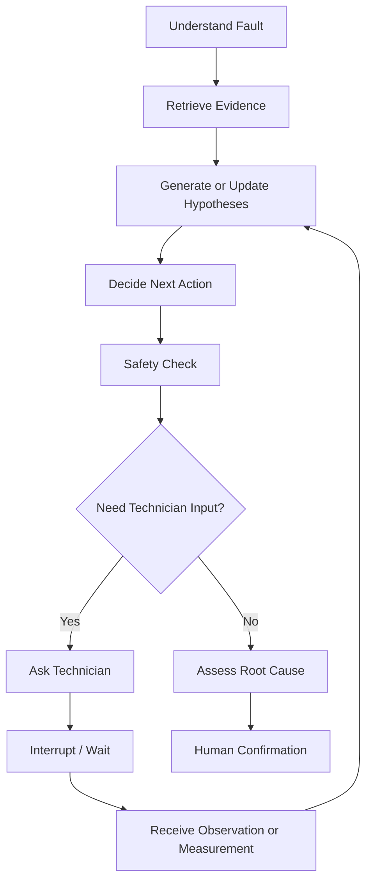

# SALLIH — User Flows

**Document Version:** 1.0  
**Project Stage:** MVP v0.1  
**Status:** Implementation Baseline

---

# 1. Purpose

This document defines the primary user flows for SALLIH MVP v0.1.

It translates the product vision and MVP scope into concrete user journeys that can be implemented by the frontend, backend, AI orchestration layer, and LangGraph diagnostic workflow.

This document must be used together with:

- `01-product-vision.md`
- `02-problem-and-users.md`
- `03-mvp-scope.md`

The primary rule is:

> Every major user action must have a clear system response, persistent state transition, and recoverable failure path.

---

# 2. Primary User

The primary MVP user is:

> **Maintenance Technician / Maintenance Engineer**

The technician may interact with SALLIH from:

- desktop,
- tablet,
- or mobile-sized responsive web interface.

The technician may be:

- standing next to a machine,
- holding tools,
- wearing gloves,
- working in a noisy environment,
- communicating primarily in Arabic,
- using mixed Arabic-English industrial terminology.

Therefore, the UX must prioritize:

- short interactions,
- voice input,
- clear machine context,
- visible evidence,
- minimal typing,
- explicit confirmation of critical values.

---

# 3. Core Navigation Model

The MVP navigation should remain intentionally small.

Primary sections:

- Dashboard / Home
- Machines
- Troubleshooting
- Maintenance History
- Documents

Possible navigation structure:

```text
SALLIH
│
├── Machines
│   └── Machine Passport
│       ├── Overview
│       ├── Documents
│       ├── Maintenance History
│       └── Start Diagnosis
│
├── Troubleshooting
│   └── Diagnostic Session
│
├── Maintenance History
│   └── Maintenance Case Details
│
└── Documents
```

A complex enterprise navigation system is not required for MVP v0.1.

---

# 4. Global UX Principles

All flows must follow these principles.

## 4.1 Machine Context Must Always Be Visible

When the technician is diagnosing a fault, the interface must clearly show which machine is currently selected.

Example:

```text
Packaging Line #01
Siemens Drive System
Machine ID: PKG-001
```

The user should never wonder:

> "Which machine is the AI currently analyzing?"

---

## 4.2 Critical AI State Must Be Visible

During troubleshooting, the technician should be able to understand:

- Current fault
- Current alarm
- Collected observations
- Collected measurements
- Active hypotheses
- Current requested action
- Relevant evidence
- Diagnostic status

Hidden AI state should not be the only source of truth.

---

## 4.3 One Primary Action Per Step

The diagnostic interface should focus the technician on the next useful action.

Avoid:

```text
10 possible things to check.
```

Prefer:

```text
Next check:
Measure L1, L2, and L3 current.
```

---

## 4.4 Human Confirmation Is Required

The AI may propose:

```text
Probable root cause
```

but only the technician can confirm:

```text
Confirmed root cause
```

---

## 4.5 Evidence Must Be Inspectable

If SALLIH says:

> "F30005 may indicate overcurrent."

the technician should be able to inspect:

```text
Drive Manual
Page 74
Section 8.3
```

---

# 5. Flow Overview

The main MVP flows are:

```text
UF-01 — Sign In
UF-02 — Browse Machines
UF-03 — Open Machine Passport
UF-04 — Open Machine via QR
UF-05 — Start Diagnostic Session
UF-06 — Describe Fault by Text
UF-07 — Describe Fault by Voice
UF-08 — Review ASR Transcript
UF-09 — Structured Fault Understanding
UF-10 — Retrieve Machine Evidence
UF-11 — Guided Troubleshooting Loop
UF-12 — Submit Technician Observation
UF-13 — Submit Measurement
UF-14 — Resume Interrupted Diagnostic Session
UF-15 — Safety-Gated Diagnostic Action
UF-16 — Probable Root Cause
UF-17 — Confirm Resolution
UF-18 — Save Maintenance Case
UF-19 — Retrieve Previous Maintenance Memory
UF-20 — View Maintenance History
UF-21 — View Maintenance Case Details
UF-22 — Upload Machine Document
UF-23 — Document Processing Failure
UF-24 — Insufficient Evidence
UF-25 — AI / Tool Failure Recovery
```

---

# 6. UF-01 — Sign In

## Goal

Allow an authorized technician to access SALLIH.

## Preconditions

- Technician account exists.
- Backend is available.

## Flow

```text
User opens SALLIH
      ↓
Login screen
      ↓
User enters credentials
      ↓
Frontend sends authentication request
      ↓
Backend validates credentials
      ↓
Authentication succeeds
      ↓
User enters application
```

## Success Result

User reaches the main application.

## Failure Cases

### Invalid Credentials

Display:

```text
Incorrect email or password.
```

### Backend Unavailable

Display:

```text
SALLIH is temporarily unavailable.
Please try again.
```

## MVP Notes

No complex SSO or enterprise authentication is required.

---

# 7. UF-02 — Browse Machines

## Goal

Allow the technician to select a machine.

## Entry Point

User opens:

```text
Machines
```

## Flow

```text
Machines page
     ↓
System loads machines available to user
     ↓
Machine cards are displayed
     ↓
User selects machine
     ↓
Open Machine Passport
```

## Machine Card Information

Each card should contain at minimum:

- Machine Name
- Machine ID
- Manufacturer
- Model
- Location
- Status

Example:

```text
Packaging Line #01

ID: PKG-001
Manufacturer: DemoTech
Model: PX-200
Location: Production Hall A
```

## MVP Constraint

One demo machine is sufficient for initial MVP.

Architecture must still use explicit `machine_id`.

---

# 8. UF-03 — Open Machine Passport

## Goal

Show all relevant information associated with a machine.

## Entry Points

- Machines page
- QR scan
- Maintenance case
- Active diagnostic session

## Flow

```text
User selects machine
      ↓
Frontend requests machine details
      ↓
Backend loads Machine Passport
      ↓
Machine Passport displayed
```

## Machine Passport Sections

### Overview

- Name
- Machine ID
- Manufacturer
- Model
- Serial Number
- Year
- Location
- Description

### Documents

- Manuals
- Schematics
- Alarm References
- Parts Catalogs
- Datasheets

### Maintenance History

- Previous resolved cases

### Primary CTA

```text
Start Diagnosis
```

## Success Result

Technician can understand the selected machine context before starting diagnosis.

---

# 9. UF-04 — Open Machine via QR

## Goal

Allow the technician to quickly open the correct machine while standing near it.

## Flow

```text
Technician scans machine QR
        ↓
QR opens SALLIH machine URL
        ↓
Authentication check
        ↓
Machine ID resolved
        ↓
Machine Passport opens
```

Example route:

```text
/machines/PKG-001
```

## If User Is Not Authenticated

```text
QR Scan
  ↓
Login
  ↓
Successful authentication
  ↓
Redirect to requested machine
```

## Invalid QR

Display:

```text
Machine not found.
```

Do not silently redirect to another machine.

---

# 10. UF-05 — Start Diagnostic Session

## Goal

Create a persistent troubleshooting session tied to the selected machine.

## Entry Point

Machine Passport:

```text
Start Diagnosis
```

## Flow

```text
User clicks Start Diagnosis
        ↓
Frontend requests new session
        ↓
Backend creates Diagnostic Session
        ↓
Session receives unique ID
        ↓
LangGraph thread/checkpoint context created
        ↓
Troubleshooting screen opens
```

## Initial Diagnostic Session State

Example:

```json
{
  "session_id": "DS-001",
  "machine_id": "PKG-001",
  "status": "WAITING_FOR_FAULT_DESCRIPTION",
  "initial_fault_description": null,
  "structured_fault": null,
  "hypotheses": [],
  "observations": [],
  "measurements": [],
  "evidence": [],
  "probable_root_cause": null,
  "confirmed_root_cause": null
}
```

## Important Requirement

The diagnostic session must exist before the AI workflow starts.

This allows:

- persistence,
- recovery,
- auditability,
- LangGraph checkpointing.

---

# 11. UF-06 — Describe Fault by Text

## Goal

Allow the technician to describe a machine issue naturally.

## Example

Technician types:

```text
الدرايف عم يفصل بعد عشر دقايق وبيعطيني F30005.
```

## Flow

```text
User enters description
      ↓
User submits
      ↓
Backend stores original message
      ↓
Diagnostic graph resumes
      ↓
understand_fault node executes
```

## UI State

While processing:

```text
Understanding the fault...
```

## Success Result

The message becomes input for structured fault extraction.

---

# 12. UF-07 — Describe Fault by Voice

## Goal

Allow the technician to report a fault without typing.

## Flow

```text
User presses microphone
      ↓
Recording starts
      ↓
User speaks naturally
      ↓
User stops recording
      ↓
Audio uploaded
      ↓
ASR processes audio
      ↓
Transcript returned
      ↓
Transcript shown to user
```

## Example Speech

```text
الدرايف عم يفصل بعد شي عشر دقايق
وعم يعطيني F30005.
```

## Important Rule

ASR output must not automatically become authoritative diagnostic input.

The transcript must first pass through:

> **Transcript Review**

---

# 13. UF-08 — Review ASR Transcript

## Goal

Prevent ASR mistakes from silently changing technical meaning.

## UI

Show editable transcript:

```text
الدرايف عم يفصل بعد شي عشر دقايق
وعم يعطيني F30005.
```

Actions:

- Confirm
- Edit
- Record Again

## Flow

```text
ASR result
   ↓
Display editable transcript
   ↓
User reviews
   ↓
User confirms
   ↓
Confirmed text becomes diagnostic input
```

## Critical Token Highlighting

Where technically feasible, highlight:

```text
F30005
12.5 A
K17
Siemens
VFD
```

because these tokens may have higher diagnostic importance.

## Example Correction

ASR result:

```text
F3005
```

Technician edits:

```text
F30005
```

Only the corrected value enters diagnostic state.

---

# 14. UF-09 — Structured Fault Understanding

## Goal

Convert technician language into structured diagnostic information.

## LangGraph Node

```text
understand_fault
```

## Input

```text
Confirmed technician description
```

## Example Input

```text
الدرايف عم يفصل بعد عشر دقايق وبيعطيني F30005.
```

## Expected Structured Output

```json
{
  "component": "VFD",
  "symptom": "trip",
  "alarm_codes": ["F30005"],
  "timing": "after approximately 10 minutes",
  "operating_condition": null,
  "observations": []
}
```

## Validation

The structured result must be validated against a backend schema.

If validation fails:

```text
LLM output
   ↓
Schema validation fails
   ↓
Controlled retry
   ↓
If still invalid
   ↓
Ask technician for clarification
```

## Important Rule

Invalid free-form output must never directly mutate diagnostic state.

---

# 15. UF-10 — Retrieve Machine Evidence

## Goal

Retrieve evidence relevant to the current fault.

## LangGraph Nodes / Tools

Possible calls:

```text
load_machine_context
retrieve_documentation
search_alarm_reference
search_maintenance_memory
```

## Mandatory Retrieval Filter

```text
machine_id = current_machine_id
```

## Flow

```text
Structured fault
      ↓
Build retrieval query
      ↓
Search machine documents
      ↓
Search maintenance memory
      ↓
Rank evidence
      ↓
Attach evidence to session state
```

## Example Result

```text
Evidence 1
Drive Manual
Page 74
F30005 — Overcurrent

Evidence 2
Maintenance Case M-004
Previous drive trip after warm-up
```

## No Relevant Evidence

If nothing useful is found:

```text
No strong machine-specific documentation was found for this issue.
```

The AI must not invent a manual reference.

---

# 16. UF-11 — Guided Troubleshooting Loop

## Goal

Guide the technician iteratively toward a probable root cause.

This is the core SALLIH flow.

## High-Level LangGraph Flow



## Core Loop

```text
Evidence
   ↓
Hypotheses
   ↓
Choose next useful check
   ↓
Ask technician
   ↓
WAIT
   ↓
Receive result
   ↓
Update hypotheses
   ↓
Repeat
```

## Example

Initial hypotheses:

```text
H1 — Mechanical overload
H2 — Phase imbalance
H3 — Motor winding issue
H4 — VFD failure
```

SALLIH determines:

```text
Next most useful check:
Measure current on L1, L2 and L3.
```

The system asks only for the information most likely to reduce uncertainty.

---

# 17. UF-12 — Submit Technician Observation

## Goal

Allow technician observations to update diagnosis.

## Example Observation

```text
في صوت احتكاك من جهة الموتور.
```

## Flow

```text
Agent asks inspection question
        ↓
Graph pauses
        ↓
Technician submits observation
        ↓
Backend stores original observation
        ↓
Graph resumes
        ↓
Observation added to diagnostic state
        ↓
Hypotheses updated
```

## Evidence Type

This must be stored as:

```text
TECHNICIAN_OBSERVATION
```

not as manufacturer evidence.

---

# 18. UF-13 — Submit Measurement

## Goal

Allow structured technical measurements to influence diagnosis.

## Preferred UI

When possible, use dedicated structured fields.

Example:

```text
L1 Current: [ 8.2 ] A
L2 Current: [ 8.4 ] A
L3 Current: [ 13.9 ] A
```

Instead of relying only on free-form text.

## Flow

```text
Agent requests measurement
       ↓
Graph pauses
       ↓
Measurement form displayed
       ↓
Technician enters values
       ↓
Frontend validation
       ↓
Backend validation
       ↓
Measurement saved
       ↓
Graph resumes
       ↓
Hypotheses updated
```

## Example Stored Measurement

```json
{
  "type": "phase_current",
  "values": {
    "L1": 8.2,
    "L2": 8.4,
    "L3": 13.9
  },
  "unit": "A"
}
```

## Validation

Invalid input:

```text
L1 = abc
```

must not enter diagnostic state.

---

# 19. UF-14 — Resume Interrupted Diagnostic Session

## Goal

Allow a technician to leave the session and continue later without losing state.

## Example

```text
Agent:
Measure motor phase currents.

Technician:
Leaves application to perform measurement.
```

## Flow

```text
Graph reaches human input node
       ↓
Checkpoint saved
       ↓
Session status = WAITING_FOR_TECHNICIAN
       ↓
User leaves application
       ↓
User returns later
       ↓
Session loaded
       ↓
Previous state restored
       ↓
Pending question displayed
       ↓
User submits answer
       ↓
Graph resumes
```

## Required Persistent Data

At minimum:

- LangGraph thread/session ID
- Current checkpoint
- Pending question
- Hypotheses
- Evidence
- Observations
- Measurements
- Messages

## UX Requirement

The technician must not need to restart the diagnosis.

---

# 20. UF-15 — Safety-Gated Diagnostic Action

## Goal

Prevent unsafe AI guidance.

## Flow

```text
Agent proposes next action
        ↓
Safety classification
        ↓
LOW / MEDIUM / HIGH
```

### LOW

Continue normally.

Example:

```text
Read the displayed alarm code.
```

### MEDIUM

Provide normal technician caution.

Example:

```text
Measure phase current using appropriate equipment and site procedures.
```

### HIGH

Do not directly instruct execution without qualified verification.

Example UI:

```text
High-Risk Maintenance Action

This step involves hazardous electrical work.

Only a qualified technician following the site's
lockout/tagout and electrical safety procedures
should perform this action.
```

## Forbidden Flow

SALLIH must never respond with instructions such as:

```text
Bypass the safety interlock temporarily.
```

The graph must reject such actions.

---

# 21. UF-16 — Probable Root Cause

## Goal

Present the AI's best current assessment when enough evidence exists.

## Preconditions

The graph determines:

```text
sufficient_evidence = true
```

## Example

```text
Probable Root Cause

Phase imbalance related to the L3 connection.

Confidence:
High
```

Supporting information:

```text
Evidence

1. L3 current significantly higher than L1 and L2.
2. Drive Manual — Page 74.
3. Previous similar case M-004.
```

## Important UI Distinction

Display:

```text
Probable Root Cause
```

not:

```text
Confirmed Root Cause
```

until the technician confirms the real result.

---

# 22. UF-17 — Confirm Resolution

## Goal

Allow the technician to record what actually solved the fault.

## Flow

```text
Probable root cause displayed
        ↓
Technician performs appropriate repair
        ↓
Technician returns to SALLIH
        ↓
Resolve Session
        ↓
Resolution form displayed
```

## Required Fields

```text
Confirmed Root Cause
Corrective Action
```

## Optional Fields

```text
Part Replaced
Downtime
Additional Notes
```

## Example

```text
Confirmed Root Cause:
Loose L3 motor terminal

Corrective Action:
Connection cleaned and tightened

Downtime:
37 minutes
```

## Important Rule

The technician's confirmed result becomes authoritative maintenance history.

The model's earlier hypothesis remains part of the diagnostic trace but does not overwrite the confirmed result.

---

# 23. UF-18 — Save Maintenance Case

## Goal

Convert a completed diagnostic session into reusable machine memory.

## Flow

```text
Technician confirms resolution
        ↓
Diagnostic session marked RESOLVED
        ↓
Maintenance Case generated
        ↓
Diagnostic summary generated
        ↓
Structured maintenance data saved
        ↓
Case indexed for future retrieval
```

## Maintenance Case Contents

- Machine
- Initial Complaint
- Structured Symptoms
- Alarm Codes
- Observations
- Measurements
- Diagnostic Steps
- Retrieved Evidence
- Probable Root Cause
- Confirmed Root Cause
- Corrective Action
- Parts Used
- Downtime
- Resolved Date
- Technician

## Result

The case becomes part of:

> **Machine Memory**

---

# 24. UF-19 — Retrieve Previous Maintenance Memory

## Goal

Use confirmed historical cases during future diagnosis.

## Example

New session:

```text
الدرايف عم يعطي overcurrent بعد شوي من التشغيل.
```

Retrieval finds:

```text
Case M-004

Similar symptom:
Drive trip after warm-up

Confirmed cause:
Loose L3 terminal
```

## Expected AI Behavior

SALLIH should communicate:

```text
A similar previous case exists on this machine.

Previous confirmed cause:
Loose L3 terminal.

The current issue should still be verified independently.
```

## Forbidden Behavior

Do not assume:

```text
Same symptom = same root cause.
```

Maintenance Memory provides evidence, not certainty.

---

# 25. UF-20 — View Maintenance History

## Goal

Allow technicians to browse resolved machine cases.

## Entry Points

- Machine Passport
- Maintenance History navigation

## List Information

Each case may show:

- Case ID
- Date
- Fault Summary
- Confirmed Root Cause
- Downtime
- Technician

Example:

```text
M-004
17 Apr 2026

Fault:
Drive overcurrent after warm-up

Root Cause:
Loose L3 terminal

Downtime:
37 min
```

## Filters

MVP may support simple filters such as:

- Machine
- Component
- Alarm Code
- Date

Advanced analytics are out of scope.

---

# 26. UF-21 — View Maintenance Case Details

## Goal

Allow the technician to inspect how a previous problem was solved.

## Case Detail Sections

### Problem

- Original description
- Symptoms
- Alarm codes

### Diagnostic Evidence

- Manual references
- Measurements
- Observations

### Diagnostic Path

- Questions asked
- Checks performed
- Hypothesis updates

### Resolution

- Confirmed root cause
- Corrective action
- Parts used
- Downtime

## Primary Use

The case should help future technicians understand:

> what happened, what was checked, and what actually solved the problem.

---

# 27. UF-22 — Upload Machine Document

## Goal

Add technical documentation to a Machine Passport.

## Entry Point

```text
Machine Passport → Documents → Upload
```

## Flow

```text
User selects PDF
      ↓
Upload begins
      ↓
File stored
      ↓
Document processing job starts
      ↓
Text extraction
      ↓
OCR if required
      ↓
Chunking
      ↓
Metadata extraction
      ↓
Embedding generation
      ↓
Vector indexing
      ↓
Document status = READY
```

## Processing States

```text
UPLOADING
PROCESSING
READY
FAILED
```

## UI

Example:

```text
Siemens G120 Drive Manual.pdf

Status:
Processing...
```

Then:

```text
Status:
Ready
```

---

# 28. UF-23 — Document Processing Failure

## Goal

Handle ingestion failures without corrupting the knowledge base.

## Possible Failures

- Unreadable PDF
- OCR failure
- Parsing failure
- Embedding failure
- Unsupported encryption
- Corrupted file

## Flow

```text
Processing fails
      ↓
Document status = FAILED
      ↓
Failure reason stored
      ↓
User informed
```

Example:

```text
Document processing failed.

Reason:
The PDF could not be read.

Actions:
Retry
Replace File
Remove
```

## Important Rule

FAILED documents must not be available to RAG retrieval.

---

# 29. UF-24 — Insufficient Evidence

## Goal

Allow SALLIH to stop responsibly when available information is insufficient.

## Example Situation

The technician says:

```text
المكينة ما عم تشتغل.
```

No alarm.

No measurement.

No useful retrieved evidence.

## Correct System Behavior

```text
I do not have enough information yet to narrow the diagnosis.
```

Then ask a useful clarification such as:

```text
Does the machine power on?
```

or:

```text
Is any alarm code visible?
```

## Possible End State

If evidence remains insufficient:

```text
Unable to determine a reliable probable root cause.

Recommended next step:
Escalate to an experienced technician or OEM support.
```

## Important Rule

Failure to diagnose is an acceptable system result.

Fabricating certainty is not.

---

# 30. UF-25 — AI / Tool Failure Recovery

## Goal

Handle temporary AI or tool failures without losing the diagnostic session.

## Possible Failures

- LLM timeout
- Provider error
- Vector search failure
- ASR timeout
- Tool exception
- Network interruption

## Flow

```text
Tool call fails
      ↓
Error classified
      ↓
Safe retry if appropriate
      ↓
If retry fails
      ↓
Checkpoint preserved
      ↓
User receives recoverable error
```

Example:

```text
SALLIH could not complete this step.

Your diagnostic session has been saved.

Retry
```

## Important Requirement

A temporary model/provider failure must not delete the diagnostic session.

---

# 31. Troubleshooting Screen Layout

The main AI Troubleshooting screen should conceptually contain:

```text
┌────────────────────────────────────────────────────────────┐
│ Packaging Line #01                           Session DS-001 │
├────────────────────────────────────────────────────────────┤
│                                                            │
│ Conversation / Guided Troubleshooting                      │
│                                                            │
│ Technician: الدرايف عم يفصل...                            │
│                                                            │
│ SALLIH: Please measure L1, L2 and L3 current.             │
│                                                            │
├───────────────────────────────┬────────────────────────────┤
│ Diagnostic State              │ Evidence                   │
│                               │                            │
│ Alarm: F30005                 │ Drive Manual              │
│ Component: VFD                │ Page 74                   │
│                               │                            │
│ Hypotheses                    │ Case M-004                │
│ 1. Phase imbalance            │ Similar previous fault    │
│ 2. Mechanical overload        │                            │
│ 3. Motor issue                │                            │
├───────────────────────────────┴────────────────────────────┤
│ Voice / Text / Structured Measurement Input               │
└────────────────────────────────────────────────────────────┘
```

Exact visual design may evolve.

The information hierarchy must remain similar.

---

# 32. Diagnostic Session Statuses

Recommended session statuses:

```text
NEW

WAITING_FOR_FAULT_DESCRIPTION

ANALYZING

WAITING_FOR_TECHNICIAN

READY_FOR_ASSESSMENT

PROBABLE_CAUSE_IDENTIFIED

WAITING_FOR_RESOLUTION

RESOLVED

CANCELLED

FAILED
```

These statuses should be explicit application state.

They should not exist only inside generated text.

---

# 33. Diagnostic Flow State Ownership

Different system layers have different responsibilities.

## Frontend

Responsible for:

- User interaction
- Forms
- Voice recording
- Transcript editing
- Displaying diagnostic state
- Displaying evidence
- Resume UI

## FastAPI Backend

Responsible for:

- Authentication
- Machines
- Documents
- Diagnostic sessions
- Maintenance cases
- Validation
- Persistence
- API contracts

## LangGraph

Responsible for:

- Diagnostic orchestration
- State transitions
- Human-in-the-loop interrupt/resume
- Tool selection
- Hypothesis workflow
- Diagnostic loop

## LangChain

Responsible where appropriate for:

- LLM calls
- Structured output
- Retrieval interfaces
- Embeddings
- Tools
- Document AI integrations

## Database

Responsible for durable business data.

LangGraph checkpoints must complement the application database, not replace it.

---

# 34. User Flow and LangGraph Relationship

The UI flow and graph flow are related but must not be tightly coupled.

Example:

```text
UI:
User submits measurement

API:
POST diagnostic input

Backend:
Validate measurement

LangGraph:
Resume thread

Graph:
update_hypotheses

Graph:
decide_next_action

API:
Return new session state

UI:
Render next question
```

This separation is important for maintainability.

---

# 35. Session Persistence Principle

Every meaningful diagnostic event should be persisted.

Examples:

- Fault submitted
- Evidence retrieved
- Question asked
- Observation received
- Measurement received
- Hypothesis updated
- Probable cause produced
- Resolution confirmed

The project should support an auditable diagnostic timeline.

---

# 36. Diagnostic Timeline

A session may internally produce a timeline such as:

```text
15:02
Session created

15:03
Fault description received

15:03
Alarm F30005 extracted

15:04
Drive Manual page 74 retrieved

15:04
4 hypotheses generated

15:05
Phase-current measurement requested

15:12
Measurement received

15:12
Phase imbalance prioritized

15:14
L3 terminal inspection requested

15:20
Loose terminal confirmed

15:24
Session resolved
```

This timeline may later support:

- case review,
- evaluation,
- research analysis,
- debugging.

---

# 37. Cancellation Flow

The technician must be able to cancel an active session.

## Flow

```text
User selects Cancel Diagnosis
        ↓
Confirmation dialog
        ↓
Cancel session?
```

If confirmed:

```text
status = CANCELLED
```

Existing data may remain for audit/debugging but must not become Maintenance Memory.

Only resolved sessions become confirmed maintenance cases.

---

# 38. Start New Diagnosis After Resolution

Once a session is resolved:

```text
RESOLVED
```

it must remain immutable as a completed diagnostic record except for explicitly allowed administrative corrections.

A new fault requires:

```text
New Diagnostic Session
```

Do not reopen an old resolved session as though it were the current fault.

---

# 39. Flow for Similar Previous Case

Example complete flow:

```text
New Fault
   ↓
Understand Fault
   ↓
Search Machine Documentation
   ↓
Search Machine Memory
   ↓
Similar Case Found
   ↓
Display as Historical Evidence
   ↓
Generate Current Hypotheses
   ↓
Continue Current Diagnosis
```

Historical cases must influence but not determine current diagnosis.

---

# 40. Future Flow Compatibility

The MVP flows should be designed so future capabilities can be added without redesigning the core diagnostic model.

Potential future inputs:

- Image
- Thermal Image
- PLC Alarm
- Sensor Reading
- Live Telemetry
- Audio Machine Noise

Potential future tools:

- Parts Intelligence
- OEM Search
- PLC Diagnostics
- Predictive Models
- Work Order Integration

These are not part of MVP v0.1.

The MVP should only avoid architectural decisions that would make such expansion unnecessarily difficult.

---

# 41. Primary End-to-End Demo Flow

The official SALLIH MVP demonstration should follow this exact narrative.

## Step 1 — Open Machine

Technician scans QR code.

SALLIH opens:

```text
Packaging Line #01
```

---

## Step 2 — Start Diagnosis

Technician selects:

```text
Start Diagnosis
```

Session created:

```text
DS-001
```

---

## Step 3 — Voice Description

Technician says:

```text
الدرايف عم يفصل بعد عشر دقايق
وعم يعطيني overcurrent.
```

---

## Step 4 — Transcript Confirmation

SALLIH shows transcript.

Technician confirms it.

---

## Step 5 — Fault Understanding

SALLIH extracts:

```text
Component:
VFD / Motor

Symptom:
Trip

Timing:
After approximately 10 minutes

Fault:
Overcurrent
```

---

## Step 6 — Evidence Retrieval

SALLIH retrieves:

```text
Drive Manual
Relevant overcurrent section
```

---

## Step 7 — Hypothesis Generation

Possible hypotheses:

```text
Mechanical overload
Phase imbalance
Motor problem
Wiring issue
Drive fault
```

---

## Step 8 — Guided Check

SALLIH asks:

```text
Please measure current on L1, L2 and L3.
```

The graph pauses.

---

## Step 9 — Technician Measurement

Technician enters:

```text
L1 = 8.2 A
L2 = 8.4 A
L3 = 13.9 A
```

---

## Step 10 — Resume

LangGraph resumes the same thread.

SALLIH updates hypotheses.

---

## Step 11 — Next Check

SALLIH explains:

```text
L3 is significantly higher than the other phases.

Please inspect the L3 motor connection according to the site's electrical safety procedure.
```

---

## Step 12 — Real Finding

Technician finds:

```text
Loose L3 terminal
```

---

## Step 13 — Probable Root Cause

SALLIH displays:

```text
Probable Root Cause:
Poor L3 electrical connection causing phase imbalance and overcurrent.
```

with supporting evidence.

---

## Step 14 — Technician Confirmation

Technician confirms:

```text
Confirmed Root Cause:
Loose L3 terminal

Corrective Action:
Connection tightened
```

---

## Step 15 — Maintenance Memory

The session becomes:

```text
Maintenance Case M-001
```

---

## Step 16 — Demonstrate Memory

A later diagnostic session starts with a similar fault.

SALLIH retrieves:

```text
Previous Case M-001
```

and uses it as historical evidence.

This final step demonstrates that SALLIH does not merely answer questions.

It builds:

> **persistent machine knowledge.**

---

# 42. Flow Acceptance Criteria

The user-flow layer of MVP v0.1 is complete when the following workflow can be performed without developer intervention:

```text
Login
↓
Select or scan machine
↓
Open Machine Passport
↓
Start diagnosis
↓
Describe fault via voice
↓
Review transcript
↓
Confirm transcript
↓
Structured fault created
↓
Machine evidence retrieved
↓
Diagnostic hypotheses created
↓
Next diagnostic action requested
↓
Graph pauses
↓
Technician provides observation or measurement
↓
Graph resumes
↓
Hypotheses update
↓
Probable root cause produced
↓
Evidence displayed
↓
Technician confirms real resolution
↓
Maintenance case created
↓
Case appears in Maintenance History
↓
Future session can retrieve the case
```

If any of these transitions require manual database modification, code modification, or developer intervention, the MVP user flow is not complete.

---

# 43. Final User Flow Principle

The central SALLIH user experience is not:

```text
Ask AI
↓
Receive Answer
```

It is:

```text
Describe Fault
      ↓
Gather Evidence
      ↓
Form Hypotheses
      ↓
Perform Check
      ↓
Provide Result
      ↓
Update Diagnosis
      ↓
Repeat
      ↓
Confirm Real Resolution
      ↓
Preserve Knowledge
```

That iterative flow is the defining experience of SALLIH.