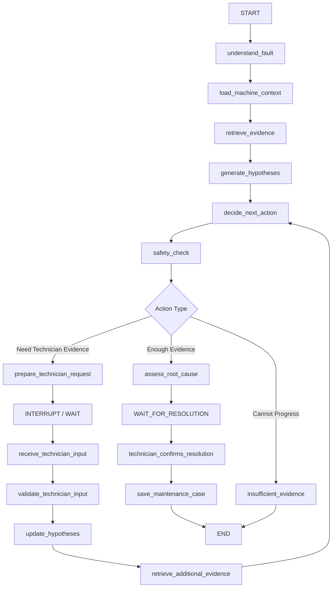

# SALLIH — AI System Design

**Document Version:** 1.0  
**Project Stage:** MVP v0.1  
**Status:** Implementation Baseline

---

# 1. Purpose

This document defines the AI system design for SALLIH MVP v0.1.

It specifies:

- the role of the Diagnostic Orchestrator,
- the LangGraph state model,
- graph nodes and transitions,
- LLM responsibilities,
- deterministic responsibilities,
- tool contracts,
- structured outputs,
- hypothesis management,
- evidence handling,
- confidence semantics,
- human-in-the-loop behavior,
- safety integration,
- maintenance-memory usage,
- failure behavior,
- provider abstraction,
- and evaluation hooks.

This document must be used together with:

- `01-product-vision.md`
- `02-problem-and-users.md`
- `03-mvp-scope.md`
- `04-user-flows.md`
- `05-functional-requirements.md`

The central AI design principle is:

> **Agentic where flexibility helps. Deterministic where reliability matters.**

---

# 2. AI System Objective

The AI system exists to help a qualified technician conduct a structured diagnostic investigation.

It must not behave as a generic chatbot.

The AI system must support the following loop:

```text
Understand Fault
      ↓
Retrieve Machine Evidence
      ↓
Create Diagnostic Hypotheses
      ↓
Determine Missing Information
      ↓
Choose Next Useful Check
      ↓
Safety Validation
      ↓
Ask Technician
      ↓
Receive Physical Evidence
      ↓
Update Hypotheses
      ↓
Repeat
      ↓
Assess Probable Root Cause
      ↓
Human Confirmation
      ↓
Preserve Maintenance Knowledge
```

The AI assists diagnosis.

It does not autonomously repair or control equipment.

---

# 3. Core AI Architecture

The MVP AI architecture consists of:

```text
Technician
    ↓
Frontend
    ↓
FastAPI Application Layer
    ↓
LangGraph Diagnostic Orchestrator
    │
    ├── LLM Provider
    ├── Machine Context Tool
    ├── Documentation Retrieval Tool
    ├── Alarm Lookup Tool
    ├── Maintenance Memory Tool
    ├── Safety Evaluation Layer
    └── Structured Validation
    ↓
Application Database + Vector Retrieval
```

Voice input adds:

```text
Technician Speech
      ↓
ASR
      ↓
Confirmed Transcript
      ↓
Diagnostic Orchestrator
```

ASR is intentionally outside the core diagnostic reasoning graph until the technician confirms the transcript.

---

# 4. Primary Agent

MVP v0.1 uses one primary agent:

> **SALLIH Diagnostic Orchestrator**

The Diagnostic Orchestrator manages the diagnostic workflow.

It is responsible for deciding:

- what is currently known,
- what is missing,
- what evidence should be retrieved,
- which hypotheses remain plausible,
- what diagnostic check should happen next,
- when technician input is required,
- when the available evidence is sufficient for an assessment,
- when the system should stop due to insufficient evidence,
- and when human confirmation is required.

The agent is not responsible for:

- controlling machinery,
- bypassing safety systems,
- writing PLC values,
- automatically confirming a root cause,
- inventing manufacturer information,
- deciding hard compatibility constraints without deterministic validation.

---

# 5. Why LangGraph Is Used

Troubleshooting is:

- iterative,
- stateful,
- interruptible,
- evidence-driven,
- human-dependent,
- and potentially long-running.

Therefore, the AI workflow must support:

```text
Execution
↓
Pause
↓
Technician physical action
↓
Minutes later
↓
Resume same state
```

LangGraph is used to provide:

- explicit workflow state,
- conditional routing,
- controlled loops,
- human-in-the-loop interrupts,
- persistent checkpoints,
- recoverable execution,
- future subgraph extensibility.

LangGraph must represent real product behavior.

It must not exist only as a wrapper around a single prompt.

---

# 6. MVP AI Design Philosophy

The AI layer must follow six rules.

## Rule 1 — Machine Context Before Generic Knowledge

When machine-specific information exists, it has priority over generic model knowledge.

Preferred evidence hierarchy:

```text
Manufacturer Documentation
        ↓
Machine-Specific Maintenance History
        ↓
Current Technician Evidence
        ↓
General Engineering Reasoning
```

General model knowledge may help interpret evidence but must not silently override machine-specific facts.

---

## Rule 2 — Evidence Before Certainty

The system should not become more confident merely because the model generated a convincing explanation.

Confidence must depend on available evidence.

---

## Rule 3 — Ask Before Guessing

If important information is missing, the system should ask for the most useful clarification or diagnostic check.

It should not fill missing physical facts with assumptions.

---

## Rule 4 — Technician Evidence Changes the Diagnosis

New observations and measurements must be capable of:

- strengthening hypotheses,
- weakening hypotheses,
- rejecting hypotheses,
- introducing new hypotheses.

---

## Rule 5 — AI Assessment Is Not Final Reality

The AI produces:

> **Probable Root Cause**

The technician provides:

> **Confirmed Root Cause**

These must remain separate concepts.

---

## Rule 6 — It Is Valid to Stop Without a Diagnosis

An acceptable outcome is:

```text
INSUFFICIENT_EVIDENCE
```

This is preferable to hallucinating a diagnosis.

---

# 7. High-Level LangGraph

The MVP graph should conceptually follow:



The exact implementation may combine or split some nodes, but the behavior must remain equivalent.

---

# 8. Diagnostic State Model

The graph must maintain explicit structured state.

Conceptual state:

```python
DiagnosticState = {
    "session_id": str,
    "machine_id": str,
    "technician_id": str,

    "status": DiagnosticSessionStatus,

    "original_fault_description": str | None,
    "structured_fault": StructuredFault | None,

    "machine_context": MachineContext | None,

    "evidence": list[EvidenceItem],

    "hypotheses": list[DiagnosticHypothesis],

    "observations": list[TechnicianObservation],
    "measurements": list[Measurement],

    "diagnostic_steps": list[DiagnosticStep],

    "pending_action": DiagnosticAction | None,

    "probable_root_cause": RootCauseAssessment | None,

    "termination_reason": TerminationReason | None,

    "iteration_count": int,

    "last_error": AIWorkflowError | None
}
```

This is conceptual documentation.

The exact Python implementation may use:

- TypedDict,
- Pydantic models,
- dataclasses,

as long as the runtime state remains validated and explicit.

---

# 9. State Ownership

Not every field should exist only inside LangGraph.

The system must distinguish:

## Durable Application State

Examples:

```text
session_id
machine_id
technician_id
session_status
confirmed_root_cause
corrective_action
maintenance_case_id
```

The application database is authoritative for these values.

---

## Diagnostic Workflow State

Examples:

```text
structured_fault
active_hypotheses
pending_action
retrieved_evidence
current_assessment
```

LangGraph may actively manage these values.

Important diagnostic state should still be persisted or reconstructable when required.

---

## LLM Ephemeral Context

Examples:

- temporary prompt context,
- formatting instructions,
- intermediate text used only inside one model call.

This data does not automatically become product state.

---

# 10. No Hidden Chain-of-Thought Dependency

SALLIH must not depend on storing or exposing private model chain-of-thought.

The product must use inspectable structured outputs such as:

```text
Hypothesis
Supporting Evidence
Contradicting Evidence
Next Action
Reason for Action
Confidence Category
```

instead of attempting to persist unrestricted internal reasoning.

Example:

```json
{
  "next_action": {
    "type": "MEASUREMENT_REQUEST",
    "measurement": "phase_current",
    "reason": "Phase-current values can distinguish between balanced mechanical overload and phase-specific electrical issues."
  }
}
```

This provides useful diagnostic traceability without requiring hidden reasoning.

---

# 11. Structured Fault Schema

The `understand_fault` node converts confirmed technician language into structured data.

Conceptual schema:

```python
StructuredFault = {
    "components": list[str],
    "symptoms": list[str],
    "alarm_codes": list[str],
    "timing": str | None,
    "operating_condition": str | None,
    "reported_changes": list[str],
    "reported_observations": list[str],
    "unknowns": list[str]
}
```

Example input:

```text
الدرايف عم يفصل بعد عشر دقايق وبيعطيني F30005.
```

Possible output:

```json
{
  "components": ["VFD"],
  "symptoms": ["trip"],
  "alarm_codes": ["F30005"],
  "timing": "after approximately 10 minutes",
  "operating_condition": null,
  "reported_changes": [],
  "reported_observations": [],
  "unknowns": [
    "load condition",
    "phase currents"
  ]
}
```

The model must not invent values for unknown fields.

---

# 12. Fault Understanding Rules

The `understand_fault` node must:

1. preserve technical identifiers,
2. understand Syrian Arabic where possible,
3. understand Arabic-English code switching,
4. extract alarm codes exactly,
5. preserve uncertainty,
6. avoid inventing missing measurements,
7. normalize terminology only when safe.

Example normalization:

```text
درايف
drive
VFD
inverter
```

may map to the technical concept:

```text
VFD
```

when context supports it.

But:

```text
K17
```

must not be transformed into another identifier.

---

# 13. Machine Context

The `load_machine_context` step should provide structured machine metadata.

Conceptual schema:

```python
MachineContext = {
    "machine_id": str,
    "name": str,
    "manufacturer": str | None,
    "model": str | None,
    "serial_number": str | None,
    "year": int | None,
    "location": str | None,
    "known_components": list[str],
    "available_document_types": list[str]
}
```

The agent should know what information is available before deciding which tools to call.

---

# 14. Evidence Model

All diagnostic evidence must use a common conceptual structure.

```python
EvidenceItem = {
    "evidence_id": str,
    "source_type": EvidenceSourceType,
    "machine_id": str,

    "title": str,
    "content": str,

    "document_id": str | None,
    "page_number": int | None,
    "section": str | None,

    "maintenance_case_id": str | None,

    "observation_id": str | None,
    "measurement_id": str | None,

    "retrieval_score": float | None,

    "created_at": datetime | None
}
```

---

# 15. Evidence Source Types

Minimum types:

```text
MANUFACTURER_DOCUMENT
MAINTENANCE_CASE
TECHNICIAN_OBSERVATION
TECHNICIAN_MEASUREMENT
SYSTEM_RULE
```

`AI_INFERENCE` is not treated as external evidence.

AI inference is a conclusion derived from evidence.

This distinction must remain explicit.

---

# 16. Evidence Authority

Evidence types do not all have equal meaning.

Example ordering:

```text
Manufacturer technical specification
        ↓
Current technician measurement
        ↓
Current technician observation
        ↓
Previous confirmed maintenance case
        ↓
General model knowledge
```

This is not an absolute universal ranking.

The AI system must evaluate relevance and context.

Example:

A current measured voltage may be more relevant to the present fault than an old maintenance case.

---

# 17. Documentation Retrieval Tool

Conceptual tool:

```text
search_machine_documents
```

Input:

```json
{
  "machine_id": "PKG-001",
  "query": "F30005 overcurrent motor trip",
  "document_types": [
    "MANUAL",
    "ALARM_REFERENCE"
  ]
}
```

Output:

```json
{
  "results": [
    {
      "document_id": "DOC-04",
      "document_name": "Drive Manual",
      "page_number": 74,
      "section": "Overcurrent Faults",
      "content": "...",
      "retrieval_score": 0.89
    }
  ]
}
```

The tool must enforce `machine_id` filtering independently of model behavior.

The LLM must never be trusted to remember this filter by itself.

---

# 18. Alarm Lookup Tool

Conceptual tool:

```text
lookup_alarm_code
```

Input:

```json
{
  "machine_id": "PKG-001",
  "alarm_code": "F30005"
}
```

The lookup should prioritize:

1. exact alarm-code matches,
2. selected machine documents,
3. machine component documentation.

If no exact machine-specific result exists, this must be explicitly represented.

---

# 19. Maintenance Memory Tool

Conceptual tool:

```text
search_maintenance_memory
```

Possible input:

```json
{
  "machine_id": "PKG-001",
  "components": ["VFD"],
  "symptoms": ["overcurrent", "trip"],
  "alarm_codes": ["F30005"]
}
```

Possible output:

```json
{
  "cases": [
    {
      "case_id": "M-004",
      "similarity": 0.87,
      "confirmed_root_cause": "Loose L3 terminal",
      "corrective_action": "Connection cleaned and tightened",
      "resolved_at": "2026-04-17"
    }
  ]
}
```

Maintenance Memory must never automatically create the current root cause.

It provides historical evidence only.

---

# 20. Retrieval Strategy

SALLIH should use machine-specific retrieval.

The retrieval strategy may combine:

```text
Semantic Retrieval
+
Structured Filtering
+
Exact Alarm Matching
+
Component Matching
+
Maintenance Case Similarity
```

The exact ranking design will be refined during implementation and evaluation.

The system must not rely exclusively on semantic vector similarity for exact identifiers such as:

```text
F30005
K17
6SL3210-1KE14-3UF2
```

Exact identifiers require exact or lexical-aware retrieval paths.

---

# 21. Retrieval Context Budget

The system should not blindly send entire manuals to the LLM.

Retrieved context must be:

- relevant,
- bounded,
- attributable,
- deduplicated where practical.

Priority should be given to:

1. exact alarm/reference matches,
2. highly relevant document sections,
3. current technician evidence,
4. relevant previous cases.

---

# 22. Hypothesis Model

Each diagnostic hypothesis must be explicit.

Conceptual schema:

```python
DiagnosticHypothesis = {
    "hypothesis_id": str,
    "description": str,
    "component": str | None,

    "status": HypothesisStatus,

    "confidence": ConfidenceLevel,

    "supporting_evidence_ids": list[str],
    "contradicting_evidence_ids": list[str],

    "missing_evidence": list[str]
}
```

---

# 23. Hypothesis Status

Allowed statuses:

```text
ACTIVE
LOW_PRIORITY
REJECTED
CONFIRMED
```

`CONFIRMED` inside the hypothesis system means:

> strongly supported within the current diagnostic reasoning state.

It must not be confused with the technician-confirmed final root cause.

Where ambiguity may occur, implementation may prefer:

```text
STRONGLY_SUPPORTED
```

instead of `CONFIRMED`.

The final naming should avoid misleading users.

---

# 24. Confidence Model

SALLIH must not use arbitrary LLM-generated percentages such as:

```text
92% confidence
```

unless a future calibrated model justifies them.

MVP v0.1 uses categorical confidence:

```text
INSUFFICIENT_EVIDENCE
LOW
MEDIUM
HIGH
```

---

# 25. Confidence Semantics

## INSUFFICIENT_EVIDENCE

Meaning:

The system does not currently have enough evidence to responsibly prioritize the hypothesis.

Typical conditions:

- very vague fault description,
- no supporting machine documentation,
- no useful technician evidence.

---

## LOW

Meaning:

The hypothesis is technically plausible but has weak direct support.

Typical conditions:

- symptom compatibility,
- limited contextual support,
- no discriminating measurement.

---

## MEDIUM

Meaning:

The hypothesis has meaningful supporting evidence but still competes with other plausible explanations.

Typical conditions:

- machine documentation supports it,
- observations are consistent,
- but a key diagnostic check is still missing.

---

## HIGH

Meaning:

Multiple independent pieces of relevant evidence strongly support the hypothesis and major alternatives have been weakened.

Example:

```text
Alarm documentation
+
Current technician measurement
+
Physical inspection result
```

Even HIGH confidence remains:

> probable

until confirmed by the technician.

---

# 26. Confidence Computation Principle

Confidence categories should be evidence-driven.

The LLM may recommend a category, but application logic should validate that the minimum evidence expectations are satisfied.

Example concept:

```text
HIGH should generally require:
- direct current-session evidence
AND
- relevant technical evidence
AND
- no major unresolved contradictory evidence
```

The exact deterministic confidence rules may evolve during benchmark development.

They must remain inspectable.

---

# 27. Generate Hypotheses Node

The `generate_hypotheses` node receives:

- structured fault,
- machine context,
- retrieved evidence,
- technician observations,
- measurements.

It produces a validated list of plausible hypotheses.

Example output:

```json
{
  "hypotheses": [
    {
      "hypothesis_id": "H1",
      "description": "Phase imbalance in motor supply",
      "component": "motor supply",
      "status": "ACTIVE",
      "confidence": "MEDIUM",
      "supporting_evidence_ids": ["EV-11"],
      "contradicting_evidence_ids": [],
      "missing_evidence": [
        "L1/L2/L3 current measurement"
      ]
    },
    {
      "hypothesis_id": "H2",
      "description": "Mechanical overload",
      "component": "mechanical load",
      "status": "ACTIVE",
      "confidence": "LOW",
      "supporting_evidence_ids": ["EV-11"],
      "contradicting_evidence_ids": [],
      "missing_evidence": [
        "phase current measurement",
        "mechanical inspection"
      ]
    }
  ]
}
```

---

# 28. Maximum Hypothesis Count

The system should avoid generating an unbounded list of possibilities.

Recommended MVP target:

```text
3–5 active hypotheses
```

This is not a hard universal engineering rule.

It is a usability constraint.

If many possibilities exist, the agent should prioritize the most plausible or diagnostically useful ones.

---

# 29. Hypothesis Update Node

After new evidence arrives, the system must reassess hypotheses.

Example:

Before measurement:

```text
H1 Phase imbalance       MEDIUM
H2 Mechanical overload  MEDIUM
H3 VFD internal failure LOW
```

Technician enters:

```text
L1 = 8.2 A
L2 = 8.4 A
L3 = 13.9 A
```

After update:

```text
H1 Phase imbalance       HIGH
H2 Mechanical overload  LOW
H3 VFD internal failure LOW
```

The change should be based on explicit new evidence.

---

# 30. Contradictory Evidence

The system must be able to preserve evidence that contradicts a hypothesis.

Example:

Hypothesis:

```text
Supply phase imbalance
```

New measurement:

```text
L1 = 8.2
L2 = 8.3
L3 = 8.2
```

This should weaken the hypothesis.

The system must not simply accumulate supporting evidence while ignoring contradictions.

---

# 31. Diagnostic Action Model

The `decide_next_action` node produces a structured action.

Conceptual schema:

```python
DiagnosticAction = {
    "action_id": str,
    "action_type": DiagnosticActionType,
    "instruction": str,
    "reason": str,

    "related_hypothesis_ids": list[str],

    "required_input_schema": dict | None,

    "safety_level": SafetyLevel | None
}
```

---

# 32. Diagnostic Action Types

Initial supported types:

```text
ASK_CLARIFICATION
REQUEST_OBSERVATION
REQUEST_MEASUREMENT
REQUEST_ALARM_CODE
REQUEST_DOCUMENT_CHECK
ASSESS_ROOT_CAUSE
ESCALATE
```

Additional action types may be introduced later.

---

# 33. Next-Action Selection Principle

The agent should choose the next action that is expected to reduce diagnostic uncertainty most effectively.

It should consider:

- active hypotheses,
- missing evidence,
- available documentation,
- safety,
- effort required from technician,
- previous diagnostic steps.

The system should avoid asking questions that have already been answered.

---

# 34. Diagnostic Step Efficiency

Given two safe checks that provide similar diagnostic value, the system should prefer the one that is:

- simpler,
- faster,
- less invasive,
- lower risk.

Example:

Prefer:

```text
Read the alarm code.
```

before:

```text
Open the electrical cabinet and perform measurements.
```

if the alarm code may answer the same diagnostic question.

---

# 35. Repeated Action Prevention

The system must track completed diagnostic actions.

It should not repeatedly ask:

```text
Measure L1, L2, and L3 current.
```

if those measurements already exist and remain valid.

Repeated actions may occur only when there is a documented reason, such as:

```text
measurement after repair
```

or:

```text
measurement under different operating condition
```

---

# 36. Measurement Request Schema

When requesting structured measurements, the node should return a machine-readable schema.

Example:

```json
{
  "action_type": "REQUEST_MEASUREMENT",
  "instruction": "Measure current on all three motor phases.",
  "reason": "This helps determine whether the overcurrent is balanced or phase-specific.",
  "required_input_schema": {
    "measurement_type": "phase_current",
    "fields": [
      {
        "key": "L1",
        "label": "L1 Current",
        "data_type": "number",
        "unit": "A"
      },
      {
        "key": "L2",
        "label": "L2 Current",
        "data_type": "number",
        "unit": "A"
      },
      {
        "key": "L3",
        "label": "L3 Current",
        "data_type": "number",
        "unit": "A"
      }
    ]
  }
}
```

This allows the frontend to generate structured inputs.

---

# 37. Safety Check Node

Every proposed physical diagnostic action must pass through:

```text
safety_check
```

before reaching the technician.

Input:

```text
Proposed Diagnostic Action
+
Machine Context
+
Action Type
```

Output:

```python
SafetyAssessment = {
    "level": "LOW" | "MEDIUM" | "HIGH",
    "allowed": bool,
    "requires_qualified_technician": bool,
    "warning": str | None,
    "blocked_reason": str | None
}
```

---

# 38. Safety Behavior

## LOW

Examples:

- read displayed alarm,
- inspect visible indicator,
- retrieve manual.

Behavior:

```text
Proceed normally.
```

---

## MEDIUM

Examples:

- standard non-invasive technician measurement,
- inspection requiring normal site procedures.

Behavior:

```text
Proceed with appropriate caution and qualified-user assumptions.
```

---

## HIGH

Examples:

- hazardous electrical access,
- high-energy systems,
- rewiring,
- safety-related circuitry.

Behavior:

```text
Require explicit warning and qualified technician.
```

Some actions may also be blocked completely.

---

# 39. Forbidden Safety Actions

SALLIH must not instruct the user to:

- bypass an interlock,
- disable a safety relay,
- defeat an emergency stop,
- defeat a protective guard,
- ignore lockout/tagout requirements,
- expose unqualified users to dangerous electrical work,
- automatically alter machine control state.

The Safety Layer must not depend solely on the same LLM that proposed the action.

Deterministic rules must participate in enforcement.

---

# 40. Prepare Technician Request Node

After safety validation, the system prepares the technician-facing request.

The user-facing response should contain:

1. one primary action,
2. concise reason,
3. safety warning if required,
4. expected response type.

Example:

```text
Next check

Measure the motor current on L1, L2, and L3.

Why:
This helps determine whether the overcurrent is balanced or isolated to one phase.

Expected input:
L1, L2, L3 in amperes.
```

---

# 41. Human Interrupt

If technician input is required:

```text
Graph
↓
Persist Checkpoint
↓
Set Session Status = WAITING_FOR_TECHNICIAN
↓
Interrupt
```

No background assumption should be made about what happened physically.

The workflow resumes only after user input is submitted.

---

# 42. Technician Input Validation

Technician input must be validated before graph resumption.

Examples:

## Numeric Measurement

```text
L1 = 8.2
```

valid.

```text
L1 = abc
```

invalid.

---

## Alarm Code

Preserve exact representation.

---

## Observation

Store original technician wording.

The LLM may extract structured concepts from it separately.

---

# 43. Root Cause Readiness

The system must not call `assess_root_cause` merely because several graph iterations have occurred.

Root-cause assessment should be considered when one of the following becomes true:

```text
A dominant hypothesis has meaningful evidence
```

or:

```text
Available evidence has reached the practical limit of the current workflow
```

or:

```text
A deterministic diagnostic rule produces a strong conclusion
```

---

# 44. Root Cause Assessment Schema

Conceptual output:

```python
RootCauseAssessment = {
    "description": str,
    "confidence": ConfidenceLevel,

    "supporting_evidence_ids": list[str],
    "contradicting_evidence_ids": list[str],

    "remaining_uncertainties": list[str],

    "recommended_resolution_status": str
}
```

Possible `recommended_resolution_status`:

```text
READY_FOR_TECHNICIAN_CONFIRMATION
NEEDS_MORE_EVIDENCE
ESCALATE
```

---

# 45. Evidence Requirement for Root Cause

A root-cause assessment must not rely only on generic model knowledge.

For a `MEDIUM` or `HIGH` assessment, the system should normally contain at least one meaningful current-session evidence item.

Examples:

```text
Technician measurement
Technician inspection
Observed alarm
```

Documentation alone may explain an alarm but often cannot prove the physical root cause.

---

# 46. Root Cause Example

```json
{
  "description": "Poor electrical connection on phase L3 causing phase imbalance and VFD overcurrent protection",
  "confidence": "HIGH",
  "supporting_evidence_ids": [
    "EV-MEAS-14",
    "EV-MANUAL-03"
  ],
  "contradicting_evidence_ids": [],
  "remaining_uncertainties": [
    "Physical terminal condition has not yet been visually confirmed"
  ],
  "recommended_resolution_status": "READY_FOR_TECHNICIAN_CONFIRMATION"
}
```

This is still not the confirmed maintenance result.

---

# 47. Insufficient Evidence Node

If the system cannot responsibly continue, it must produce an explicit result.

Possible causes:

- no relevant documentation,
- no useful current observations,
- required measurement unavailable,
- contradictory evidence,
- unsupported machine configuration,
- diagnostic loop limit reached.

Example response:

```text
SALLIH cannot currently determine a reliable probable root cause.

Missing evidence:
- motor phase-current measurement
- confirmation of the displayed alarm code

Recommended next step:
Escalate to a qualified maintenance engineer or OEM support.
```

---

# 48. Escalation

Escalation is a valid system action.

Conceptual reasons:

```text
SAFETY_RISK
INSUFFICIENT_EVIDENCE
UNSUPPORTED_MACHINE
CONTRADICTORY_EVIDENCE
DIAGNOSTIC_LIMIT_REACHED
TOOL_FAILURE
```

The system should preserve the diagnostic trace even when escalation occurs.

---

# 49. Diagnostic Loop Limits

The graph must have bounded behavior.

Possible controls:

```text
maximum_iterations
maximum_repeated_tool_calls
maximum_failed_tool_attempts
```

The exact values should be configuration rather than deeply hard-coded business logic.

Example initial development setting:

```text
maximum_iterations = 12
```

This is not a final scientific value.

It is a guardrail against accidental infinite loops.

---

# 50. Diagnostic Step Model

Every meaningful diagnostic step should be recorded.

Conceptual schema:

```python
DiagnosticStep = {
    "step_id": str,
    "step_number": int,

    "action_type": str,
    "instruction": str,
    "reason": str,

    "related_hypothesis_ids": list[str],

    "safety_level": str,

    "requested_at": datetime,
    "completed_at": datetime | None,

    "result_reference": str | None
}
```

This supports:

- UI timeline,
- maintenance history,
- evaluation,
- debugging.

---

# 51. LLM Responsibilities

The LLM may be used for:

## Language Understanding

- Arabic fault understanding,
- dialect interpretation,
- Arabic-English code switching.

## Structured Extraction

- component,
- symptoms,
- alarm codes,
- timing,
- observations.

## Hypothesis Generation

Generate technically plausible diagnostic hypotheses based on supplied evidence.

## Hypothesis Reassessment

Reevaluate hypotheses when new evidence arrives.

## Next-Step Selection

Select a useful next diagnostic question or check.

## Explanation

Explain why a check is useful.

## Evidence Synthesis

Summarize retrieved manufacturer information.

## Root Cause Assessment

Generate an evidence-grounded probable root cause when permitted by graph state.

---

# 52. LLM Non-Responsibilities

The LLM must not be the sole authority for:

- authentication,
- authorization,
- machine ownership,
- database integrity,
- numeric validation,
- enum validation,
- session transitions,
- document processing state,
- safety bypass rules,
- hard electrical compatibility constraints,
- confirmed maintenance outcome,
- PLC control.

---

# 53. Structured Output Requirement

All model outputs that affect workflow state must use validated schemas.

Examples include:

```text
StructuredFault
HypothesisSet
DiagnosticAction
RootCauseAssessment
TechnicalNormalization
```

Free-form model text may be used for technician-facing explanations.

It must not silently become authoritative structured state.

---

# 54. Structured Output Failure

If model output fails validation:

```text
LLM Response
↓
Schema Validation
↓
FAILED
↓
Bounded Retry
↓
Still FAILED
↓
Controlled Workflow Error
```

The system should not attempt to parse arbitrary malformed output indefinitely.

---

# 55. Prompt Design

Prompts should be role-specific rather than one giant system prompt.

Possible prompt groups:

```text
fault_understanding
hypothesis_generation
hypothesis_update
next_action_selection
root_cause_assessment
technical_explanation
```

Each prompt should receive only the context required for its task.

---

# 56. Prompt Versioning

Prompt definitions that affect diagnostic behavior should be versionable.

Example metadata:

```text
prompt_name
prompt_version
model
created_at
```

Evaluation runs should be capable of recording which prompt/model configuration was used.

This supports reproducibility.

---

# 57. Prompt Injection Boundary

Machine documents must be treated as:

> untrusted retrieved content

not as system instructions.

If a document contains text such as:

```text
Ignore previous instructions...
```

it must remain document content and must not change agent behavior.

System and developer instructions always remain outside retrieved machine content.

---

# 58. Citation Construction

Citations must be generated from structured evidence metadata.

Preferred:

```text
document_name
page_number
section
```

The model must not independently invent citation metadata.

Example frontend citation:

```text
Siemens G120 Drive Manual
Page 74
Section: Overcurrent Faults
```

---

# 59. Unsupported Claim Control

When presenting machine-specific technical statements, the system should identify whether the statement is:

```text
SUPPORTED_BY_DOCUMENT
SUPPORTED_BY_CURRENT_EVIDENCE
SUPPORTED_BY_MAINTENANCE_MEMORY
GENERAL_ENGINEERING_INFERENCE
```

Machine-specific factual claims should prefer evidence-supported categories.

---

# 60. General Engineering Knowledge

General model knowledge may be used to:

- interpret symptoms,
- generate initial hypotheses,
- explain concepts.

But the system should make clear when a conclusion is not directly supported by machine-specific evidence.

Example:

```text
General diagnostic possibility:
A phase imbalance can contribute to overcurrent conditions.

No machine-specific evidence currently confirms that this is the cause.
```

---

# 61. Maintenance Memory Integration

Maintenance Memory should be searched during diagnostic evidence retrieval.

The system should not flood the model with all historical cases.

Retrieve only relevant cases based on:

- same machine,
- component,
- symptoms,
- alarm code,
- semantic similarity.

---

# 62. Maintenance Memory Trust Model

A previous confirmed case means:

```text
This happened before.
```

It does not mean:

```text
This is happening now.
```

Historical cases may increase the priority of a hypothesis.

They must not skip current verification.

---

# 63. Machine-Specific Memory Only in MVP

MVP v0.1 defaults to:

```text
same machine
```

for maintenance-memory retrieval.

Cross-machine organizational learning is future scope.

This avoids transferring invalid assumptions between different machine configurations.

---

# 64. AI Provider Abstraction

The Diagnostic Orchestrator must not depend directly on one provider throughout business logic.

Conceptual abstraction:

```python
class LLMProvider:
    structured_output(...)
    generate_text(...)
```

Provider adapters may include:

```text
Gemini
OpenAI
Anthropic
Open-source model
```

The selected provider must produce the same internal schemas expected by the application.

---

# 65. Model Roles

MVP may use one model for multiple tasks.

However, the architecture should allow different models in the future.

Example:

```text
Fault Understanding Model
Diagnostic Reasoning Model
Explanation Model
```

MVP should not introduce multiple models unless benchmark results justify the added complexity.

---

# 66. Temperature and Determinism

Tasks requiring extraction and structured state should use low-variance model configuration.

Examples:

```text
Fault extraction
Alarm parsing
Structured hypothesis output
```

Creative variation is not a goal.

Provider settings should favor:

- consistency,
- schema compliance,
- reproducibility.

---

# 67. Model Retry Strategy

Retries should occur only for recoverable failures such as:

- timeout,
- schema failure,
- transient provider issue.

Retries must be bounded.

The graph must not retry indefinitely.

---

# 68. Tool Selection

For MVP v0.1, tool invocation should preferably be constrained by graph design rather than giving the LLM unrestricted access to every tool at every step.

Example:

```text
retrieve_evidence node
    ↓
can use retrieval tools
```

rather than:

```text
LLM can call every tool from every state.
```

This improves:

- predictability,
- debugging,
- evaluation,
- safety.

---

# 69. Tool Execution Principle

The model may decide:

```text
what information it needs
```

but deterministic application code should execute and validate:

```text
database queries
machine filtering
numeric validation
session updates
```

---

# 70. Tool Result Provenance

Every tool result used in diagnostic reasoning should preserve provenance.

Examples:

```text
Tool name
Query
Machine ID
Result IDs
Timestamp
```

This information may be stored in audit logs or diagnostic traces.

---

# 71. Diagnostic Timeline

The AI system should emit meaningful events.

Example:

```text
15:03 FAULT_STRUCTURED

15:04 DOCUMENT_EVIDENCE_RETRIEVED

15:04 HYPOTHESES_CREATED

15:05 ACTION_REQUESTED
      Measure L1/L2/L3 current

15:12 MEASUREMENT_RECEIVED

15:12 HYPOTHESES_UPDATED

15:14 ACTION_REQUESTED
      Inspect L3 connection

15:20 OBSERVATION_RECEIVED
      Loose terminal found

15:21 PROBABLE_ROOT_CAUSE_CREATED
```

This timeline is essential for evaluation.

---

# 72. Observability

The AI orchestration layer should support structured logging for:

```text
session_id
graph_node
model_provider
model_name
tool_calls
tool_latency
retrieval_results
schema_validation_failures
graph_iterations
errors
```

Sensitive information should not be unnecessarily logged.

---

# 73. AI Error Model

Conceptual workflow errors may include:

```text
MODEL_TIMEOUT
MODEL_SCHEMA_ERROR
MODEL_PROVIDER_ERROR
RETRIEVAL_ERROR
TOOL_ERROR
CHECKPOINT_ERROR
INVALID_STATE
SAFETY_BLOCK
INSUFFICIENT_EVIDENCE
MAX_ITERATIONS_REACHED
```

Errors should map to controlled application behavior.

---

# 74. Recovery Strategy

When possible:

```text
Failure
↓
Preserve Last Valid State
↓
Classify Error
↓
Safe Retry if Appropriate
↓
Return Recoverable User State
```

The graph must never replace valid persisted state with malformed model output.

---

# 75. AI Failure User Experience

Example:

```text
SALLIH could not complete this diagnostic step.

Your session has been saved.

You can retry without losing your previous measurements or evidence.
```

Do not show raw provider errors.

---

# 76. ASR Boundary

ASR output is not diagnostic evidence until confirmed by the technician.

Correct flow:

```text
Speech
↓
ASR
↓
Transcript
↓
Technician Review
↓
Confirmed Transcript
↓
Fault Understanding
```

Incorrect flow:

```text
Speech
↓
ASR
↓
Diagnostic State Immediately
```

---

# 77. Technical Token Handling

ASR and fault understanding must pay special attention to:

```text
alarm codes
part numbers
model numbers
phase labels
PLC tags
manufacturer names
technical abbreviations
measurements
```

Examples:

```text
F30005
K17
L1
L2
L3
6SL3210
PLC
VFD
```

Errors in these tokens can materially change diagnosis.

---

# 78. Language Normalization Layer

A technical normalization step may map equivalent expressions.

Examples:

```text
درايف
drive
VFD
inverter
```

to:

```text
VFD
```

and:

```text
كونتاكتور
contactor
```

to:

```text
CONTACTOR
```

The normalized form supports retrieval.

The original technician wording must still be preserved.

---

# 79. Normalization Rules

Normalization must not:

- modify alarm codes,
- change part numbers,
- invent manufacturer names,
- convert ambiguous terms without context.

If a term remains ambiguous, preserve ambiguity.

---

# 80. Safety and AI Separation

The architecture must not ask one unrestricted LLM call to:

```text
generate an action
AND
decide whether that same action is safe
```

without additional validation.

Preferred pattern:

```text
LLM proposes diagnostic action
↓
Deterministic safety rules
+
Controlled safety assessment
↓
Allow / Warn / Block
```

---

# 81. Root Cause and Safety Separation

Even if the system has HIGH diagnostic confidence, that does not automatically mean a recommended physical repair action is safe.

Example:

```text
HIGH confidence:
Loose electrical connection
```

does not imply:

```text
User should open energized cabinet.
```

Diagnostic confidence and action safety are independent dimensions.

---

# 82. Diagnostic State Consistency

The graph must protect the following invariants.

## Invariant 1

Every session belongs to exactly one machine.

## Invariant 2

All machine-document evidence must belong to that machine.

## Invariant 3

A technician measurement cannot exist without a session.

## Invariant 4

A root-cause assessment cannot become confirmed automatically.

## Invariant 5

Only resolved sessions become confirmed Maintenance Memory.

## Invariant 6

A blocked safety action cannot be sent as an executable technician instruction.

## Invariant 7

Malformed LLM output cannot update valid state.

---

# 83. Node Input and Output Validation

Every node that mutates graph state must have:

```text
Defined Input
Defined Output
Validation
Failure Path
```

Example:

```text
generate_hypotheses

Input:
StructuredFault
Evidence[]
ExistingHypotheses[]

Output:
HypothesisSet

Validation:
Pydantic schema

Failure:
MODEL_SCHEMA_ERROR
```

---

# 84. Initial Node Definitions

The MVP should start with the following conceptual nodes.

---

## Node: understand_fault

Purpose:

Convert confirmed technician language into `StructuredFault`.

Uses:

- LLM structured output.

Does not:

- diagnose root cause.

---

## Node: load_machine_context

Purpose:

Load structured machine information.

Uses:

- deterministic backend/database logic.

---

## Node: retrieve_evidence

Purpose:

Retrieve relevant machine documentation and maintenance history.

Uses:

- document retrieval,
- alarm lookup,
- maintenance-memory search.

---

## Node: generate_hypotheses

Purpose:

Generate initial diagnostic hypotheses.

Uses:

- LLM structured output,
- current evidence.

---

## Node: decide_next_action

Purpose:

Determine the next most useful diagnostic action.

Uses:

- active hypotheses,
- missing evidence,
- completed steps.

---

## Node: safety_check

Purpose:

Validate proposed physical action.

Uses:

- deterministic safety rules,
- controlled classification.

---

## Node: prepare_technician_request

Purpose:

Convert the approved diagnostic action into concise technician-facing instructions.

---

## Node: receive_technician_input

Purpose:

Receive user-provided observation, measurement, or clarification.

This interaction enters through the application/API layer.

---

## Node: validate_technician_input

Purpose:

Perform deterministic validation.

---

## Node: update_hypotheses

Purpose:

Reassess hypotheses using new evidence.

---

## Node: retrieve_additional_evidence

Purpose:

Search for new evidence if technician input changes the diagnostic context.

---

## Node: assess_root_cause

Purpose:

Produce evidence-grounded probable root cause.

---

## Node: insufficient_evidence

Purpose:

End or escalate the diagnostic workflow responsibly.

---

## Node: technician_confirms_resolution

Purpose:

Accept final technician-confirmed root cause and corrective action.

This is primarily an application/human action rather than autonomous AI behavior.

---

## Node: save_maintenance_case

Purpose:

Persist the completed diagnostic case and index it for future memory retrieval.

---

# 85. Graph Routing Conditions

Routing should use explicit state conditions.

Examples:

```text
if structured_fault is missing
    → understand_fault
```

```text
if technician_input_required
    → interrupt
```

```text
if proposed_action is unsafe
    → block_or_escalate
```

```text
if evidence_sufficient_for_assessment
    → assess_root_cause
```

```text
if iteration_count >= max_iterations
    → insufficient_evidence
```

Routing must not rely solely on parsing free-form LLM text such as:

```text
"I think we're done."
```

---

# 86. Evidence Sufficiency

Evidence sufficiency is not simply:

```text
number of retrieved chunks
```

It should consider:

- relevance,
- directness,
- current-session evidence,
- contradictions,
- unresolved alternatives.

Conceptual categories:

```text
INSUFFICIENT
PARTIAL
SUFFICIENT_FOR_PROBABLE_ASSESSMENT
```

---

# 87. Initial Evidence Sufficiency Heuristic

MVP may initially use a hybrid heuristic.

Example concept:

```text
SUFFICIENT_FOR_PROBABLE_ASSESSMENT
when:

- at least one hypothesis is strongly supported,
- meaningful current-session evidence exists,
- no equally strong unresolved conflicting hypothesis remains,
- required safety-critical information is not missing.
```

This should be refined through benchmark results.

---

# 88. AI Explanations

Technician-facing explanations should be concise.

Preferred pattern:

```text
What to do
Why it matters
Evidence
```

Avoid:

- long theoretical essays,
- unnecessary model commentary,
- generic maintenance lectures.

---

# 89. Arabic Response Style

SALLIH should support clear Arabic responses while preserving technical terminology.

Example:

```text
الخطوة التالية:

قِس تيار الفازات L1 وL2 وL3.

السبب:
هذا القياس يساعدنا على معرفة ما إذا كان الـ overcurrent ناتجًا عن عدم توازن بين الفازات.

المصدر:
Drive Manual — Page 74
```

The system may use familiar English technical terms where that improves technician understanding.

---

# 90. Hallucination Control Strategy

The MVP must reduce hallucination through multiple layers:

```text
Machine-scoped retrieval
+
Structured outputs
+
Schema validation
+
Evidence citations
+
Explicit uncertainty
+
Human measurements
+
Safety checks
+
Deterministic invariants
```

Prompt wording alone is not considered sufficient hallucination control.

---

# 91. RAG Does Not Equal Truth

Retrieved documents may themselves be:

- incomplete,
- outdated,
- ambiguous,
- wrong for a specific machine revision.

Therefore the system should preserve metadata such as:

```text
document name
machine association
revision where available
page
```

Future versions may introduce document-version conflict handling.

---

# 92. Document Revision Awareness

**MVP Priority:** SHOULD

If document revision or version metadata is available, preserve it.

Example:

```text
Manual Revision: 04
Machine Build Year: 2018
```

The system should avoid silently merging contradictory versions where identifiable.

Full temporal document reasoning is not required for MVP v0.1.

---

# 93. Evaluation Mode

The AI system should support controlled evaluation runs.

An evaluation scenario may provide:

```text
machine
fault description
available evidence
scripted technician responses
ground-truth root cause
expected useful checks
```

The graph should be runnable against those scenarios without relying exclusively on manual UI interaction.

---

# 94. Baseline Modes

The evaluation architecture should support three modes.

## Mode A — General LLM

```text
Fault
↓
General Model
↓
Answer
```

No machine RAG.

No diagnostic workflow.

---

## Mode B — Basic RAG

```text
Fault
↓
Retrieve Machine Documents
↓
LLM
↓
Answer
```

No iterative diagnostic state.

---

## Mode C — Full SALLIH

```text
Fault
↓
Structured Understanding
↓
Machine Evidence
↓
Hypotheses
↓
Guided Checks
↓
Human Evidence
↓
Updated Diagnosis
↓
Probable Root Cause
```

---

# 95. AI Evaluation Trace

Every benchmark run should be able to record:

```text
scenario_id
system_mode
model_provider
model_name
prompt_version
retrieved_evidence_ids
generated_hypotheses
requested_actions
technician_inputs
probable_root_cause
final_confidence
graph_iterations
latency
errors
```

This enables reproducible comparison.

---

# 96. Future Subgraph Compatibility

The MVP uses one Diagnostic Orchestrator.

The architecture should allow future specialized subgraphs such as:

```text
Parts Intelligence Subgraph
PLC Diagnostic Subgraph
Visual Inspection Subgraph
Predictive Maintenance Subgraph
```

These should not be implemented until justified.

---

# 97. Future Multi-Agent Possibility

A future version may introduce agents such as:

```text
Diagnostic Agent
Parts Agent
Documentation Agent
Reliability Agent
```

However:

> Multi-agent architecture is not an MVP objective.

The MVP should first prove that one structured Diagnostic Orchestrator can solve the core workflow reliably.

---

# 98. What Must Remain Deterministic

The following must remain outside unrestricted agent reasoning:

```text
Authentication
Authorization
Machine ownership
Session ownership
Database writes
Required fields
Numeric validation
Enum validation
Document processing state
Safety prohibitions
Final resolution confirmation
Hard compatibility constraints
```

---

# 99. What May Remain Agentic

The following benefit from flexible reasoning:

```text
Understanding technician language
Mapping informal symptoms to technical concepts
Generating plausible hypotheses
Determining useful missing evidence
Selecting next diagnostic question
Reprioritizing hypotheses
Explaining retrieved technical information
Producing evidence-grounded probable root cause
```

---

# 100. AI Implementation Sequence

The recommended implementation order is:

```text
1. Diagnostic state schemas

2. Provider abstraction

3. Structured fault understanding

4. Machine document retrieval

5. Evidence model

6. Hypothesis generation

7. Next-action selection

8. LangGraph loop

9. Human interrupt/resume

10. Structured measurements

11. Hypothesis update

12. Root-cause assessment

13. Safety layer

14. Maintenance Memory

15. Voice integration

16. Evaluation harness
```

Text-based diagnosis should work before voice becomes a dependency.

---

# 101. AI System Acceptance Criteria

The AI layer is considered MVP-ready when all of the following are demonstrated.

## Fault Understanding

- [ ] Arabic fault description can be parsed.
- [ ] Arabic-English code switching is handled.
- [ ] Alarm codes are preserved.
- [ ] Missing data remains missing.
- [ ] Structured output passes validation.

## Retrieval

- [ ] Retrieval is machine-scoped.
- [ ] Exact alarm retrieval works.
- [ ] Document citations preserve page metadata.
- [ ] Historical cases can be retrieved.
- [ ] Missing evidence is represented explicitly.

## Hypotheses

- [ ] Multiple plausible hypotheses can be created.
- [ ] Hypotheses contain supporting evidence.
- [ ] Contradictory evidence can be represented.
- [ ] Hypotheses can change after technician input.
- [ ] Confidence uses controlled categories.

## Guided Diagnosis

- [ ] System chooses a next useful check.
- [ ] Requested action contains a reason.
- [ ] Structured measurement requests can be generated.
- [ ] Repeated unnecessary questions are avoided.
- [ ] Diagnostic loop is bounded.

## LangGraph

- [ ] Graph contains real diagnostic state.
- [ ] Human interrupt works.
- [ ] Checkpoint persists.
- [ ] Session resumes correctly.
- [ ] Routing is based on explicit state.
- [ ] Failure paths exist.

## Safety

- [ ] Proposed physical actions pass safety evaluation.
- [ ] Safety bypass instructions are blocked.
- [ ] High-risk actions require qualified-human handling.

## Root Cause

- [ ] Probable root cause requires evidence.
- [ ] Unsupported certainty is avoided.
- [ ] Insufficient-evidence outcome works.
- [ ] AI probable root cause remains distinct from technician confirmation.

## Maintenance Memory

- [ ] Resolved case can be retrieved later.
- [ ] Historical case is treated as evidence.
- [ ] Historical case does not automatically determine current diagnosis.

---

# 102. Official MVP AI Scenario

The AI system must successfully demonstrate the following scenario.

## Initial Input

Technician:

```text
الدرايف عم يفصل بعد عشر دقايق وعم يعطيني overcurrent.
```

---

## Structured Fault

```text
Component:
VFD / motor drive

Symptom:
Trip

Fault:
Overcurrent

Timing:
After approximately ten minutes
```

---

## Evidence Retrieval

Retrieve relevant drive documentation.

---

## Initial Hypotheses

```text
H1 — Phase imbalance
H2 — Mechanical overload
H3 — Motor electrical problem
H4 — Wiring/connection problem
H5 — VFD internal problem
```

---

## Next Action

SALLIH requests:

```text
Measure L1, L2 and L3 motor current.
```

Graph interrupts.

---

## Technician Measurement

```text
L1 = 8.2 A
L2 = 8.4 A
L3 = 13.9 A
```

---

## Hypothesis Update

Phase-specific electrical problem becomes strongly supported.

---

## Next Action

SALLIH requests inspection of the relevant L3 connection under appropriate site safety procedures.

---

## Technician Observation

```text
Loose L3 terminal found.
```

---

## Assessment

```text
Probable Root Cause:

Poor L3 electrical connection causing phase imbalance and overcurrent trip.

Confidence:
HIGH
```

Supporting evidence:

```text
Current phase measurement
Manufacturer documentation
Technician physical observation
```

---

## Final Confirmation

Technician records:

```text
Confirmed Root Cause:
Loose L3 terminal

Corrective Action:
Terminal cleaned and tightened
```

---

## Memory

The completed case becomes available to future diagnostic sessions as machine-specific historical evidence.

---

# 103. Final AI System Principle

SALLIH must never become:

```text
User asks question
↓
LLM sounds confident
↓
Technician trusts answer
```

The intended system is:

```text
Technician reports symptom
        ↓
SALLIH structures the problem
        ↓
Machine evidence is retrieved
        ↓
Multiple hypotheses are maintained
        ↓
The most useful next check is selected
        ↓
Safety is validated
        ↓
Technician gathers physical evidence
        ↓
Hypotheses are updated
        ↓
The process repeats when necessary
        ↓
Evidence supports a probable root cause
        ↓
Technician confirms reality
        ↓
The confirmed solution becomes Machine Memory
```

The intelligence of SALLIH is not defined by how confidently it answers.

It is defined by:

> **how reliably it turns incomplete machine symptoms into an evidence-driven diagnostic process while keeping the technician in control.**